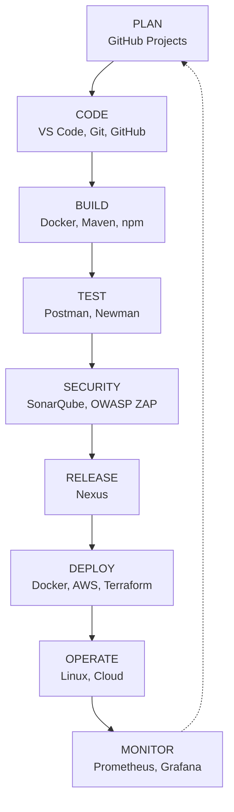

# DevOps Toolchain Map

## 1. Overview

DevOps Toolchain describes the tools used throughout the software development lifecycle, from planning and coding to deployment and monitoring.

## 2. DevOps Pipeline

## 3. Tool Description

| Stage    | Tools                  | Purpose                      |
| -------- | ---------------------- | ---------------------------- |
| Plan     | GitHub Projects        | Manage tasks and roadmap     |
| Code     | VS Code, Git, GitHub   | Write and manage source code |
| Build    | Docker, Maven, npm     | Build application            |
| Test     | Postman, Newman        | API testing                  |
| Security | SonarQube, OWASP ZAP   | Code and security analysis   |
| Release  | Nexus                  | Store build artifacts        |
| Deploy   | Docker, AWS, Terraform | Deploy application           |
| Operate  | Linux, Cloud           | Run applications             |
| Monitor  | Prometheus, Grafana    | Monitor system performance   |

## 4. CALMS Principles

- Culture: Collaboration and shared responsibility.
- Automation: Automate repetitive tasks and CI/CD.
- Lean: Reduce waste using Docker.
- Measurement: Measure build and application performance.
- Sharing: Share knowledge through documentation and code review.

## 5. CALMS in Practice

| Principle   | Practical Activity                           | Lab   |
| ----------- | -------------------------------------------- | ----- |
| Culture     | Team workflow with Git Flow and Code Review  | Lab 5 |
| Automation  | CI/CD pipeline automatically deploys website | Lab 1 |
| Automation  | Create setup-dev-env.sh automation script    | Lab 2 |
| Lean        | Use Docker to containerize applications      | Lab 2 |
| Lean        | Infrastructure as Code                       | Lab 3 |
| Measurement | Test reports and SonarQube metrics           | Lab 6 |
| Measurement | Monitor pipeline duration and success rate   | Lab 7 |
| Sharing     | Code Review on GitHub                        | Lab 5 |
| Sharing     | Create DevOps Toolchain Map                  | Lab 2 |
